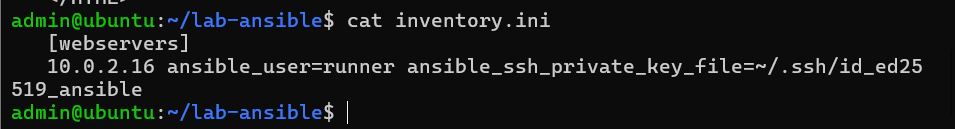
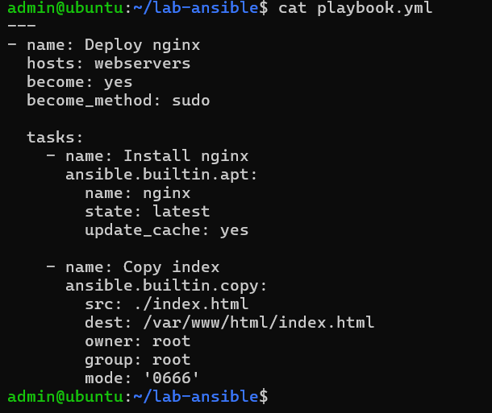
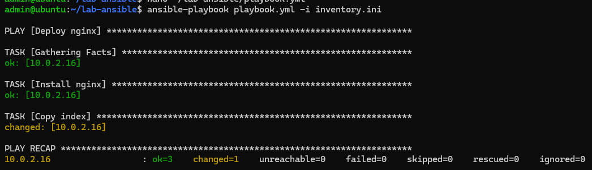
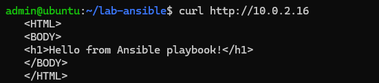

# Лабораторная работа №4: Автоматизация с помощью Ansible

**Студент:** Нечаева Полина  
**Группа:** ИТ-3,4  

## Цель работы
Изучить основы работы с системой управления конфигурациями Ansible. Настроить управление второй виртуальной машиной (Managed node) с первой (Control node) без использования пароля и развернуть веб-сервер Nginx с помощью Playbook.

## Выполненные задачи
1. Создана вторая виртуальная машина (клон) и настроена общая сеть NAT.
2. На обеих машинах настроены статические IP-адреса (`10.0.2.15` и `10.0.2.16`).
3. Настроена аутентификация по SSH-ключам (без пароля) для пользователя `runner`.
4. Установлен Ansible на Control node.
5. Написан Playbook для установки Nginx и копирования тестовой страницы `index.html`.
6. Playbook успешно выполнен, результат проверен через `curl` и браузер.

## Структура проекта
- `inventory.ini` — файл инвентаризации с описанием целевого хоста.
- `playbook.yml` — сценарий автоматизации (установка пакета и копирование файла).
- `index.html` — тестовая веб-страница для развертывания.

## Демонстрация результатов

### 1. Файл инвентаризации (inventory.ini)

### 2. Сценарий автоматизации (playbook.yml)

### 3. Успешный запуск Ansible Playbook

### 4. Проверка результата (curl)

